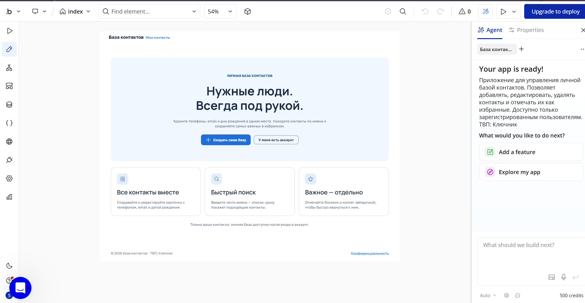
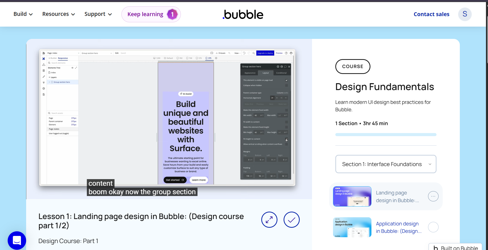
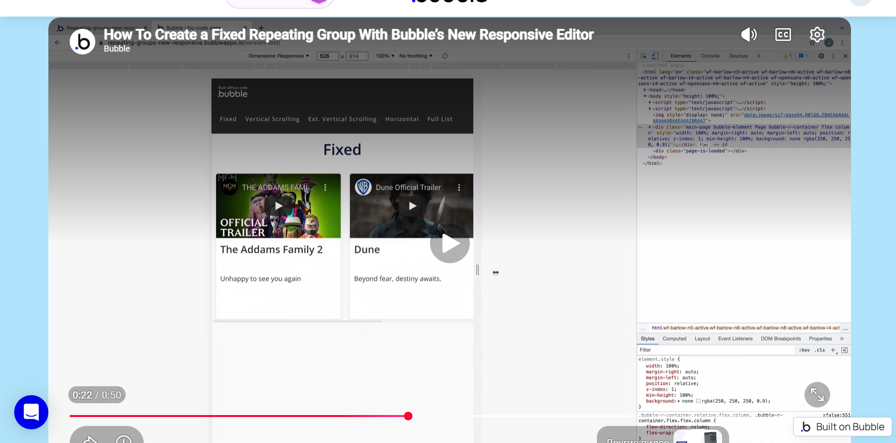
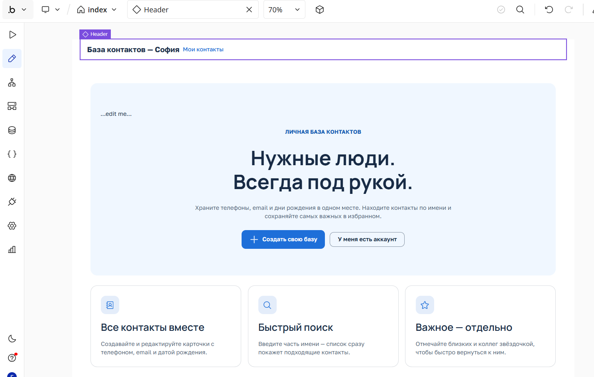

# Лабораторная работа №3 — Bubble

**Студент:** Ключник София  
**Тема:** База контактов  
**Репозиторий:** visual-programming-labs-Kliucnik-

---

## Часть 1. Промпт и генерация каркаса

### Промпт для AI-агента Bubble (дословно)
Создай приложение на тему «База контактов»

Пусть этот сайт будет требующий регистрацию.

Страницу обязательно создай по структуре header + body + footer.

Обязательно укажи в заготовке следующую строку: «ТВП: Ключник»

Добавь несколько интерактивных элементов (реализующих CRUD):

форму добавления нового контакта (имя, телефон, email, дата рождения, избранное)

список контактов с возможностью редактировать и удалять

поиск по имени

кнопку «Добавить в избранное»

### Скриншот результата генерации

Commit: Add prompt and generation result

## Часть 2. Исследование идеи (Build Guides)

### Гайд 1: Design Fundamentals

**Что посмотрела:**
Курс про основы дизайна в Bubble — работа с группами, выравнивание, стили.

**Что показалось полезным:**
- Группировка элементов (Group section)
- Настройка alignment для адаптивности
- Работа со стилями

**Что взяла в своё приложение:**
Идеи для группировки карточек контактов и отступов.

### Гайд 2: Fixed Repeating Group

**Что посмотрела:**
Гайд по Repeating Group с карточками в новом редакторе Bubble.

**Что показалось полезным:**
- Настройка Repeating Group под адаптивный layout
- Вертикальный скроллинг карточек

**Что взяла в своё приложение:**
Улучшила список контактов — карточки с отступами.

## Часть 3. Ручная доработка UI

Изменила текст заголовка в Header (reusable element) с «База контактов» на «База контактов — София».

## Часть 4. Data и Workflows

(будет заполнено)

---

## Часть 6. Отчёт

### Ссылка на dev-версию приложения

(будет заполнено)

### Выводы

(будет заполнено)
