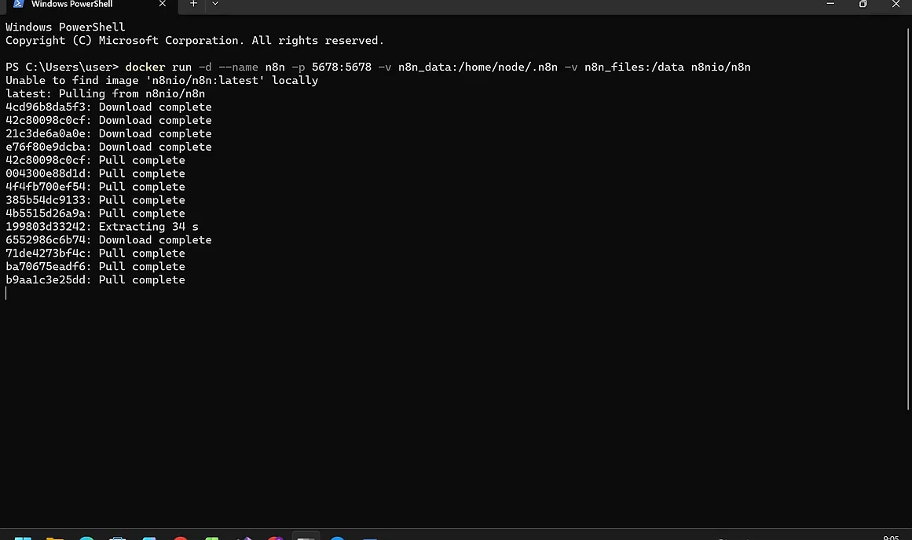
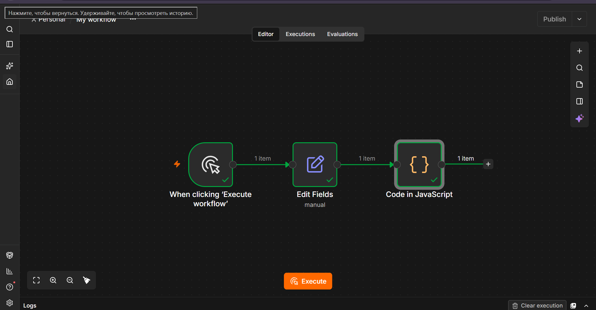
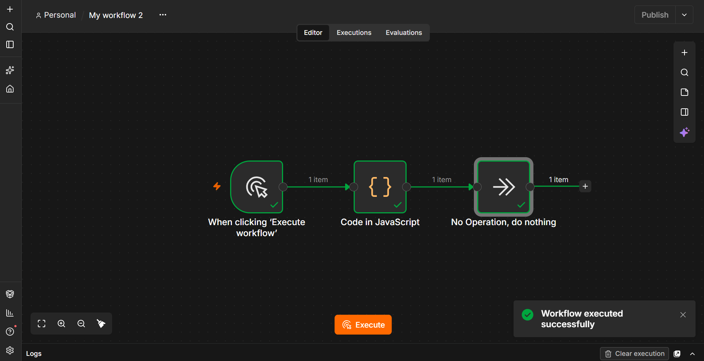
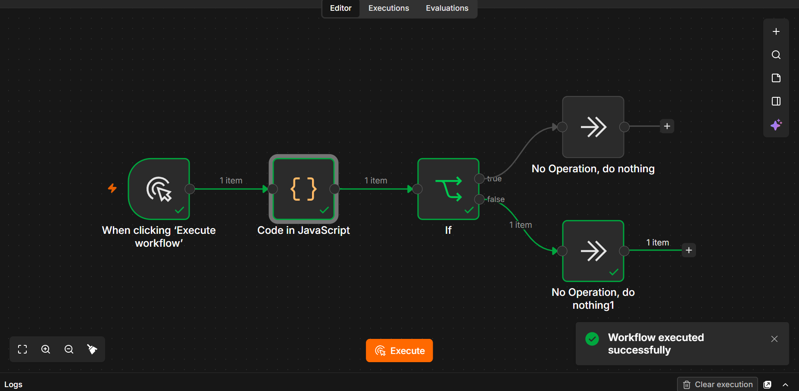
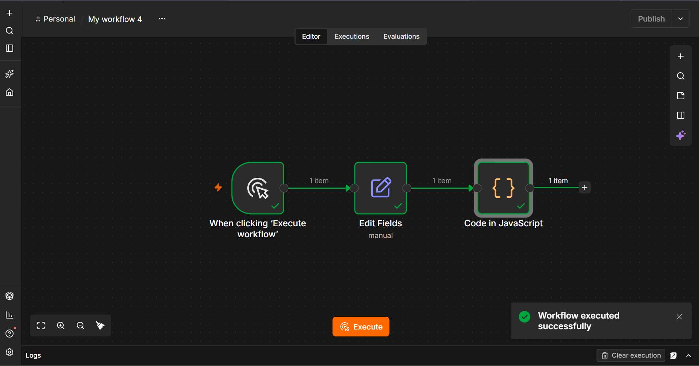
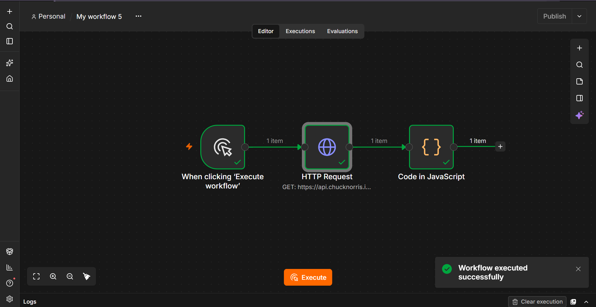
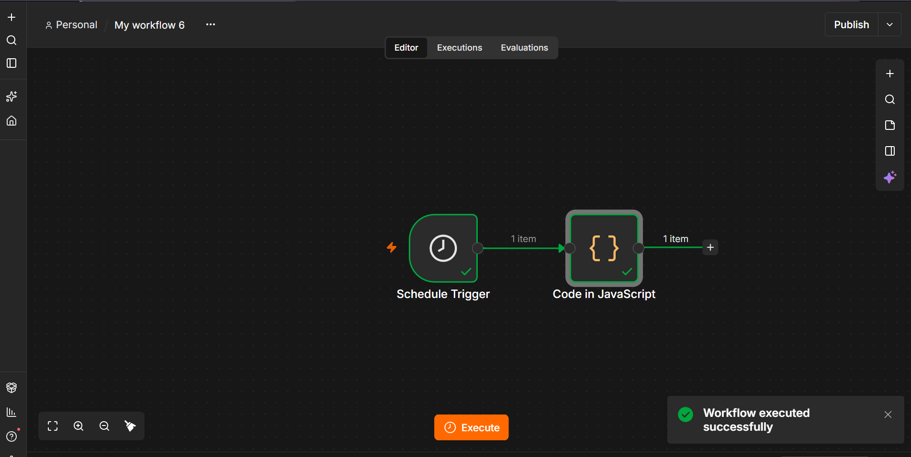

# Лабораторная работа №4 — n8n

**Студент:** Ключник София  
**Дисциплина:** Технологии визуального программирования  
**Репозиторий:** visual-programming-labs-Kliucnik-

---

## Часть 1. Установка и запуск n8n

Для запуска n8n использовался Docker. Был выполнен следующий запуск контейнера с указанием портов и volume для сохранения данных:

```bash
docker run -d --name n8n -p 5678:5678 -v n8n_data:/home/node/.n8n -v n8n_files:/data n8nio/n8n
```
Приложение успешно запущено и доступно по адресу `http://localhost:5678`. Пройдена регистрация.



---

## Часть 2. Изучение нод и создание workflow

В рамках работы были изучены базовые и продвинутые ноды. Все workflow сохранены в папке `lab4/flows/`.

### 2.1. Manual Trigger → Set → Code (Debug)

Собран workflow для ручного запуска, передачи данных через Set и вывода их в Code. В Set задан `payload = Kliucnik` и `topic = lab4/Kliucnik/basic`.



### 2.2. Code node

В ноде Code использованы базовые элементы JavaScript: `let`, `const`, `if/else`, цикл `for`, массивы и объекты. Функция возвращает объект с полем payload.



### 2.3. IF node

Настроено ветвление с помощью ноды IF. Правило проверяет значение `payload`. В зависимости от результата (true/false) поток идёт в свой NoOp.



### 2.4. Set node (изменение полей)

В ноде Set заданы поля `topic`, `timestamp` (текущее время) и `payload`. Далее в Code выводится полный объект сообщения.



### 2.5. HTTP Request node

Собран workflow с запросом к публичному API. Использован метод GET, Response Format = JSON. Запрошен случайный факт о котах (catfacts.ninja).



### 2.6. Schedule Trigger

Настроен автоматический запуск workflow по расписанию (каждую минуту для демонстрации). В ноде Code возвращается текущее время.



---

## Часть 3. Redis: создание и удаление ключа

Redis запущен через Docker:
```bash
docker run -d --name redis -p 6379:6379 redis:7
