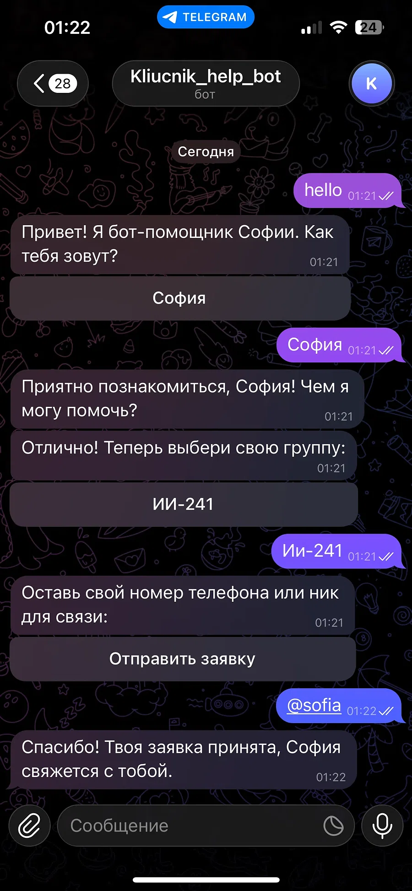
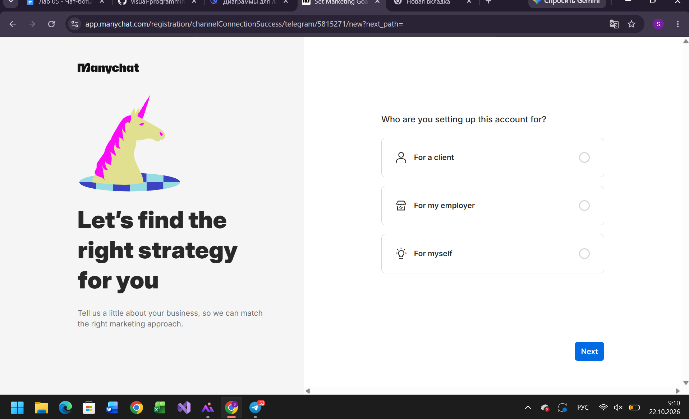
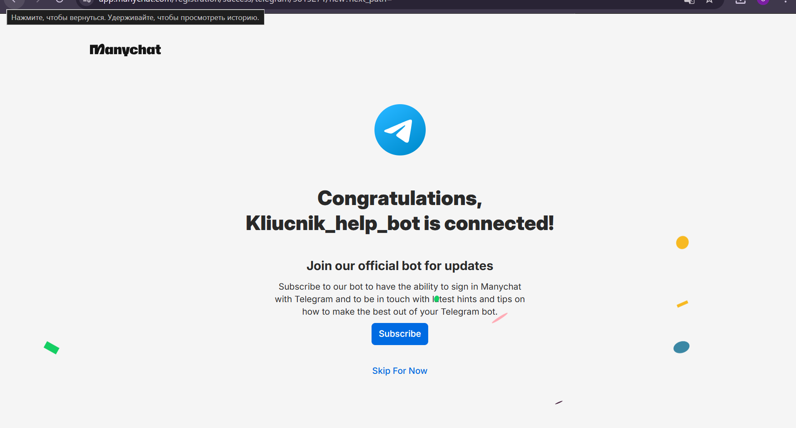
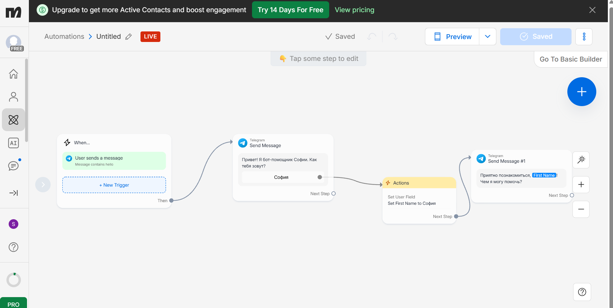
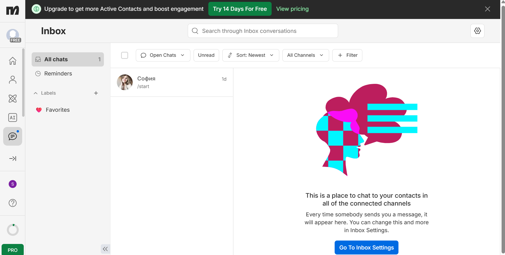
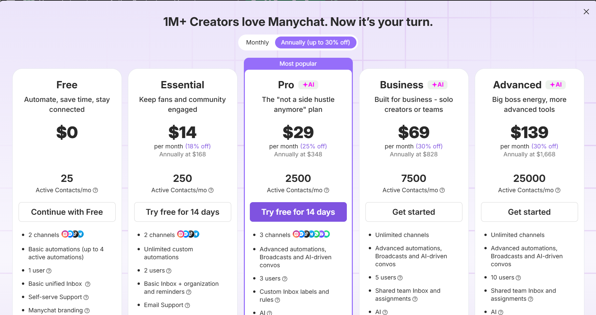

# Лабораторная работа №5. Чат-боты (Трек A. ManyChat)

## 1. Краткое описание выбранного трека
Я выбрала трек A (ManyChat). Был создан Telegram-бот `Kliucnik_help_bot` (ссылка: https://t.me/Kliucnik_help_bot). В боте реализован полный интерактивный сценарий приветствия с кнопками, сбором данных пользователя (имя, группа, контакт) и оформлением заявки.

## 2. Ссылка на бота
[Открыть бота в Telegram](https://t.me/Kliucnik_help_bot)

## 3. Использованные AI-промпты
1. «Как настроить сценарий приветствия в ManyChat с сохранением имени в переменную».
2. «Как обойти ограничение системных команд (start) и настроить кастомный триггер в ManyChat».
3. «Как сделать интерактивные кнопки для сбора данных (группа, контакт) без блока User Input».

## 4. Полный диалог с ботом (демонстрация)
Ниже описан полный сценарий взаимодействия с ботом в Telegram:
1. **Пользователь:** пишет `hello` (триггер).
2. **Бот:** отправляет сообщение *"Привет! Я бот-помощник Софии. Как тебя зовут?"* и показывает кнопку **«София»**.
3. **Пользователь:** нажимает кнопку **«София»**.
4. **Бот:** отвечает *"Приятно познакомиться, София!"* и просит выбрать группу (кнопка **«ИИ-241»**).
5. **Пользователь:** нажимает **«ИИ-241»**.
6. **Бот:** просит оставить контакт (кнопка **«Отправить заявку»**).
7. **Пользователь:** нажимает кнопку (бот фиксирует контакт).
8. **Бот:** выдает финальное сообщение *"Спасибо! Твоя заявка принята, София свяжется с тобой."*

Скриншот полной переписки (живой диалог в Telegram):

## 5. Освоенные блоки и элементы
- **Keyword trigger** (триггер по ключевому слову "hello").
- **Buttons** (кнопки быстрых ответов, останавливающие бота и ожидающие клика).
- **Custom fields** (кастомные поля: First Name, Group, Contact).
- **Actions** (Set User Field для записи данных в базу).
- **Telegram Menu** (настройка меню бота).

## 6. Скриншоты workflow и админки

**Регистрация и подключение канала:**

**Сценарий в ManyChat:**

**Админка (Inbox):**

**Ограничения Free-тарифа:**

## 7. Ограничения бесплатного тарифа ManyChat
На основе страницы тарифов ограничения Free-плана следующие:
- Не более **25 активных контактов** в месяц.
- Не более **4 активных автоматизаций** (флоу) одновременно.
- Брендинг «Powered by ManyChat» в сообщениях.
- Доступно только **2 канала**.
- Отсутствие автоматического экспорта флоу в JSON.

## 8. Выводы
В ходе работы я освоила платформу ManyChat для создания Telegram-ботов. Научилась настраивать триггеры, собирать данные пользователей с помощью кастомных полей и действий (Set User Field), а также делать интерактивные кнопки, которые останавливают выполнение сценария до клика пользователя. 
В ходе тестирования выяснилось, что системные команды (например, `/start`) перехватываются ManyChat, поэтому для кастомных сценариев использовалось ключевое слово `hello`. Логика бота собрана и успешно протестирована в Telegram.
