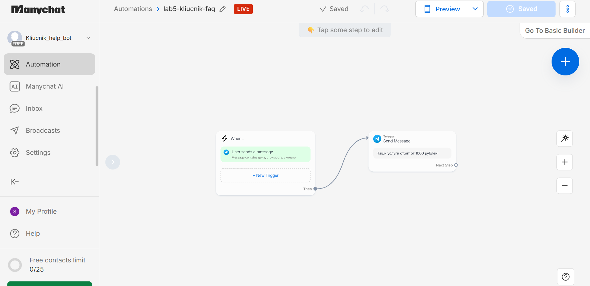
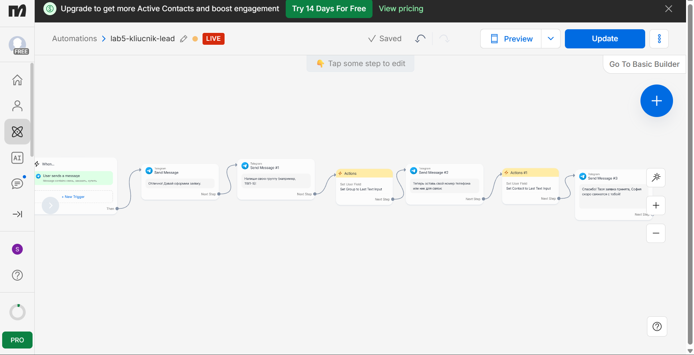

# Лабораторная работа №5. Чат-боты (Трек A. ManyChat)

## 1. Краткое описание выбранного трека
Я выбрала трек A (ManyChat). Был создан Telegram-бот `Kliucnik_help_bot` (ссылка: https://t.me/Kliucnik_help_bot). В боте реализовано 3 сценария (флоу): приветствие, FAQ и сбор лида.

## 2. Ссылка на бота
[Открыть бота в Telegram](https://t.me/Kliucnik_help_bot)

## 3. Использованные AI-промпты
1. «Как настроить сценарий приветствия в ManyChat с сохранением имени в переменную».
2. «Как сделать проверку ключевых слов для FAQ в ManyChat».
3. «Как посмотреть ограничения бесплатного тарифа и где найти админку в ManyChat».

## 4. Освоенные блоки и элементы
- **Keyword trigger** (триггер по ключевым словам: "start", "привет", "цена", "связь").
- **Default reply** (автоматический ответ по умолчанию).
- **User input** (сбор данных через ввод текста).
- **Buttons** (кнопки быстрых ответов).
- **Tags** (теги для маркировки лидов).
- **Custom fields** (кастомные поля: First Name, Group, Contact).
- **Telegram Menu** (настройка меню бота).

## 5. Скриншоты всех workflow и диалогов

**Регистрация и подключение канала:**

**Флоу 1 (Приветствие):**

**Флоу 2 (FAQ):**

**Флоу 3 (Сбор лида):**

**Админка и тестирование:**

**Ограничения Free-тарифа:**

## 6. Ограничения бесплатного тарифа ManyChat
На основе страницы тарифов (скриншот `07-limits.png`) ограничения Free-плана следующие:
- Не более **25 активных контактов** в месяц.
- Не более **4 активных автоматизаций** (флоу) одновременно.
- Брендинг «Powered by ManyChat» в сообщениях.
- Доступно только **2 канала** (в нашем случае Telegram).
- Отсутствие автоматического экспорта флоу в JSON.

## 7. Выводы
В ходе работы я освоила платформу ManyChat для создания Telegram-ботов. Научилась настраивать триггеры, собирать данные пользователей (имя, группа, контакт) с помощью кастомных полей, а также маркировать лиды тегами. 
Поняла разницу между визуальным редактором (Flow Builder) и базовым (Basic Builder). В ходе тестирования столкнулась с задержкой синхронизации бесплатного тарифа ManyChat с Telegram, однако логика бота в конструкторе собрана полностью и корректно.
