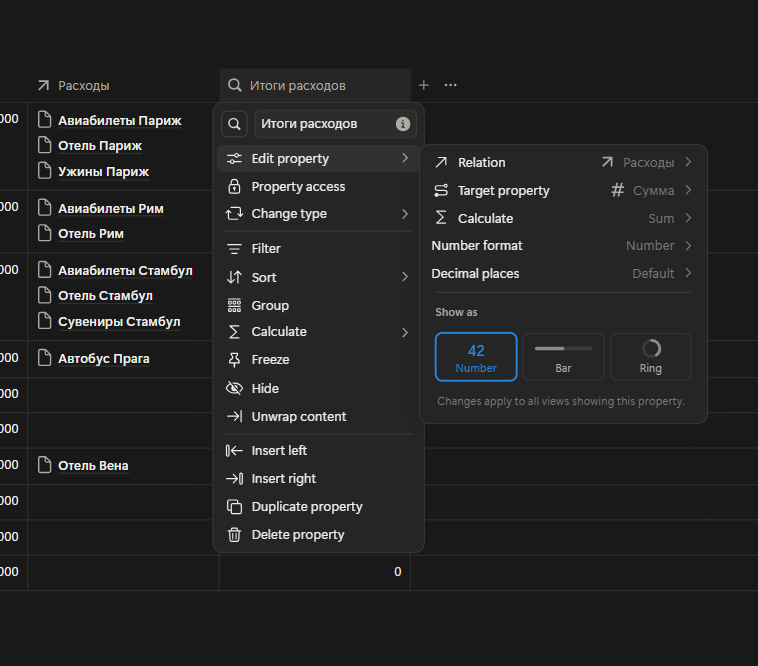
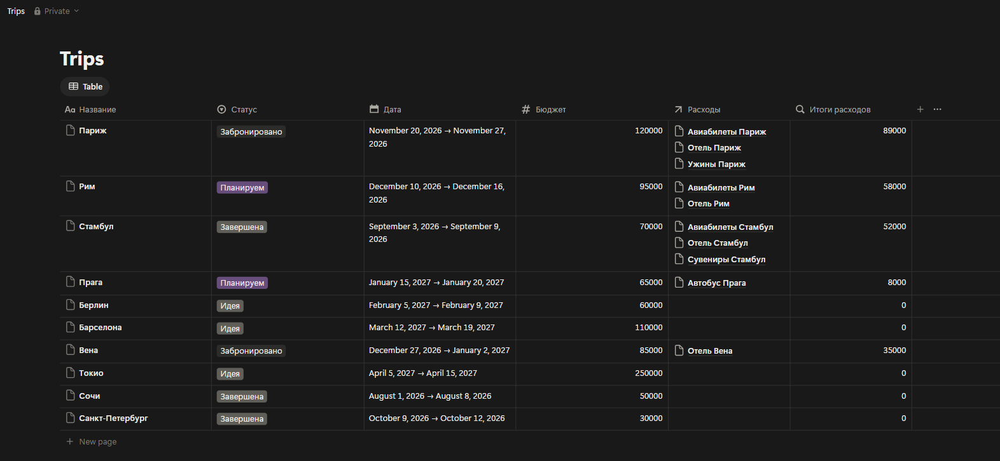
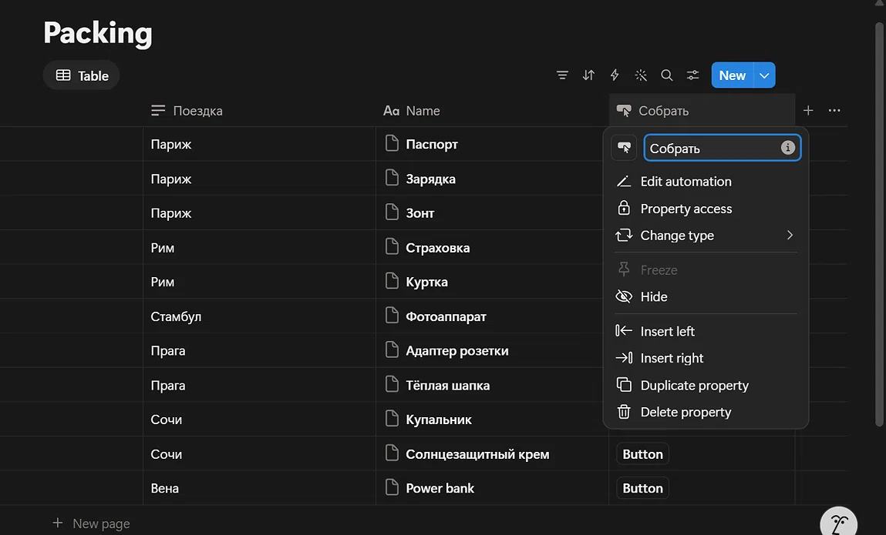
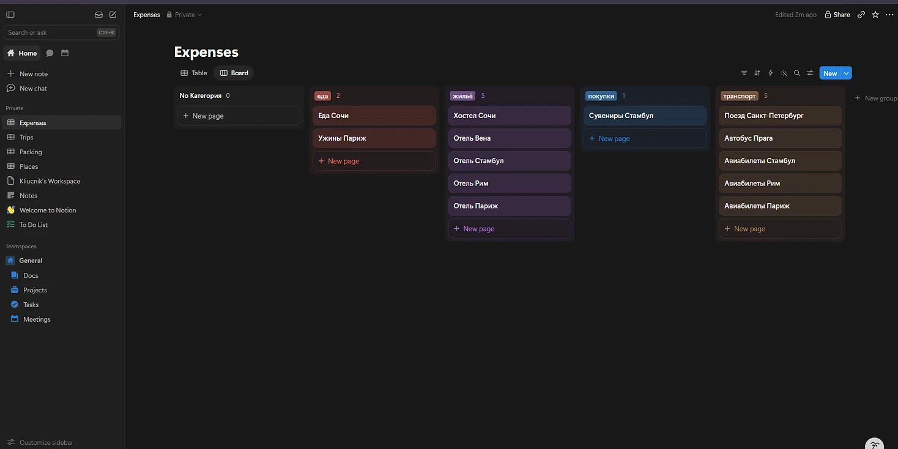
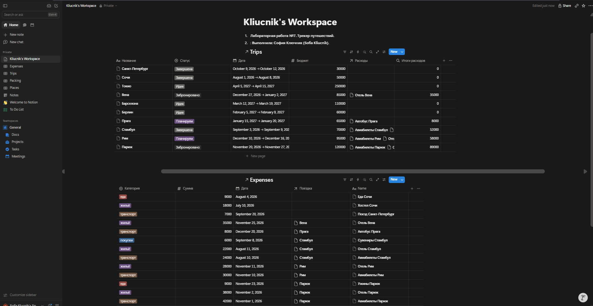

# Лабораторная работа №7. Notion

**Выполнила:** София Ключник (Sofia Kliucnik)
**Предметная область:** Трекер путешествий (учет поездок, расходов, списка вещей и посещаемых мест).

## 1. Генерация модели данных через ИИ
**Промпт для ИИ:** 
> «Придумай уникальную предметную область для учебного проекта в Notion. Нужно 3–4 связанные сущности (например, учет путешествий), минимум 2 связи Relation, свойства типов Title, Select, Date, Number, а также Formula и кнопка. Опиши модель данных и объясни, зачем нужна каждая связь».

**Что было исправлено/уточнено после ответа ИИ:**
ИИ предложил базовую модель из 2 сущностей (Поездки и Расходы). Я расширила её до 4 сущностей, добавив «Список вещей» (Packing) и «Достопримечательности» (Places), чтобы сделать проект более комплексным. Также я адаптировала типы свойств под реалии бесплатного тарифа Notion.

## 2. Модель данных и реализация
В проекте реализовано 4 связанные сущности:
1. **Trips (Поездки)** — основная база. Свойства: Название (Title), Статус (Select), Дата (Date), Бюджет (Number).
2. **Expenses (Расходы)** — связана с Trips. Свойства: Название (Title), Категория (Select), Сумма (Number), Дата (Date), Поездка (Relation).
3. **Packing (Список вещей)** — связана с Trips. Свойства: Name (Title), Категория (Select), Количество (Number), Взято (Checkbox), Поездка (Relation).
4. **Places (Места)** — связана с Trips. Свойства: Name (Title), Тип (Select), Дата (Date), Цена (Number), Поездка (Relation).

## 3. Реализованные дополнительные возможности (Ачивки)

### Ачивка 1: Rollup (Автоматический подсчет расходов)
**Что требовалось:** Использовать функцию Rollup для подсчета или агрегации данных по связанной базе. Мне нужно было автоматически считать, сколько денег ушло на каждую поездку
**Как было реализовано:** 
1. В базе `Trips` было создано новое свойство типа **Rollup** и названо «Итого расходов».
2. В настройках свойства была выбрана связь (Relation) с базой `Expenses`.
3. В качестве свойства для агрегации (Property) было выбрано числовое поле `Сумма`.
4. В качестве функции вычисления (Calculate) была выбрана **Sum** (Сумма).
**Результат:** Система автоматически суммирует все траты, привязанные к конкретной поездке, без необходимости считать вручную. 

*Скриншот 1: Настройки свойства Rollup (связь, свойство и функция Sum).*

*Скриншот 2: Результат работы Rollup (в колонке «Итого расходов» автоматически посчитаны суммы для каждой поездки).*

### Дополнительно реализовано:
- **Кнопка (Button):** В базе `Packing` создана кнопка `Собрать`, которая при нажатии автоматически ставит галочку в свойстве `Взято`. Это позволяет быстро отмечать собранные вещи.
- **Представления (Views):** В базе `Expenses` создано представление Kanban (Board), где карточки сгруппированы по столбцам в зависимости от свойства `Категория` (еда, жильё, транспорт и т.д.).

*Скриншот 3: Реализация кнопки в базе Packing.*

*Скриншот 4: Канбан-доска базы Expenses.*

## 4. Скриншоты рабочего пространства

*Скриншот 5: Главная страница рабочего пространства с фамилией.*

## 5. Ссылка на опубликованную страницу Notion
**Ссылка:** [https://northern-safflower-272.notion.site/Kliucnik-s-Workspace-4169f677213d806c9493da46cdd45156](https://northern-safflower-272.notion.site/Kliucnik-s-Workspace-4169f677213d806c9493da46cdd45156)

## 6. Ограничения бесплатного тарифа
В ходе работы я использовала Free Plan. Основные ограничения, с которыми я столкнулась:
- Ограничение на количество блоков (хотя для данной работы его хватило с запасом).
- Отсутствие полной истории версий страницы.
- Некоторые продвинутые интеграции и автоматизации доступны только на платных тарифах.

## 7. Выводы
В ходе лабораторной работы я освоила базовые и продвинутые возможности Notion как low-code платформы. Я научилась создавать связанные базы данных (Relation), настраивать вычисляемые поля (Rollup и Formula) и автоматизировать действия с помощью кнопок. Использование ИИ помогло быстро сгенерировать структуру проекта, а практическая реализация показала, насколько гибко Notion позволяет управлять данными без написания кода.
